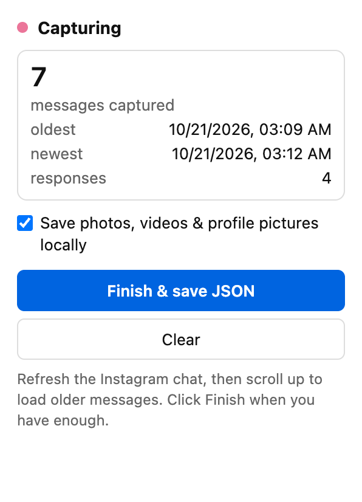
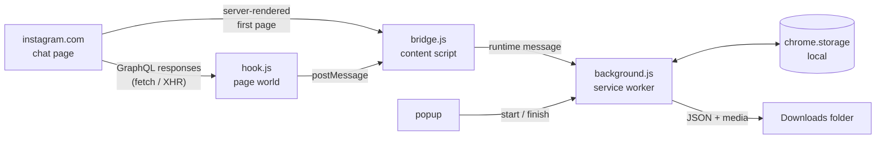

<div align="center">


# Instagram DM Capture

### Export Instagram DMs to JSON, with photos and videos, straight from your browser

A free, open-source Chrome extension that saves your Instagram direct messages (chat history, reactions, replies, photos, videos and profile pictures) as a clean, structured JSON file. No password sharing, no servers, no API keys.

[](https://github.com/IchNukeDichWeg/instagram-dm-capture/releases/latest)
[](https://developer.chrome.com/docs/extensions/develop/migrate/what-is-mv3)
[](LICENSE)
[](#privacy)

<picture>
  <source media="(prefers-color-scheme: dark)" srcset="docs/popup-dark.png">
  
</picture>

</div>

---

## Contents

- [Why](#why)
- [Features](#features)
- [Install](#install)
- [How to export an Instagram chat](#how-to-export-an-instagram-chat)
- [Output format](#output-format)
- [How it works](#how-it-works)
- [Privacy](#privacy)
- [FAQ](#faq)
- [Known limits](#known-limits)
- [Development](#development)
- [License](#license)

## Why

Instagram's own "Download your information" export takes hours to days, arrives as one large archive, and gives you every chat at once. Most of the time you want **one conversation, now**, in a format you can search, analyse or feed into another tool.

Instagram DM Capture records the messages the Instagram web app already loads while you scroll a chat, and turns them into a tidy JSON file the moment you click **Finish**.

## Features

- **Export an Instagram chat to JSON**, as far back as you scroll.
- **Download Instagram photos and videos from DMs**: optional, saved into a `media/` folder next to the JSON, with every message linking to its local file.
- **Full message detail**: text, sender, timestamp, reactions, replies (with the quoted message), forwarded, pinned, unsent and edited flags.
- **Participants list** with usernames, display names and profile pictures.
- **Several chats in one capture**: open another conversation while capturing and it becomes its own thread in the file.
- **Deduplicated and sorted** oldest to newest, however you scroll.
- **Read-only and passive**: the extension never sends a request to Instagram. It only reads responses the page already received.
- **Keeps going in the background**: closing the popup does not stop a capture or a save.

## Install

### From the release (recommended)

1. Download `instagram-dm-capture-vX.Y.Z.zip` from the [latest release](https://github.com/IchNukeDichWeg/instagram-dm-capture/releases/latest) and unzip it.
2. Open `chrome://extensions` and switch on **Developer mode** (top right).
3. Click **Load unpacked** and select the unzipped folder.
4. Pin **Instagram DM Capture** from the puzzle-piece menu so it sits in your toolbar.

### From source

```bash
git clone https://github.com/IchNukeDichWeg/instagram-dm-capture.git
```

Then load the cloned folder with **Load unpacked** as above.

Built and tested for Google Chrome. Other Chromium browsers with Manifest V3 (Edge, Brave, Opera, Arc, Vivaldi) should work but are untested.

## How to export an Instagram chat

1. Open the conversation on [instagram.com/direct](https://www.instagram.com/direct/inbox/).
2. Click the extension icon, then **Start capture**.
3. **Refresh the page.**
4. **Scroll up** in the chat. Every batch of older messages Instagram loads is captured; the popup shows the count and the oldest date reached.
5. Tick **Save photos, videos & profile pictures locally** if you want the media too.
6. Click **Finish & save JSON**.

Your export lands in your Downloads folder:

| Media option | Result |
| --- | --- |
| Off | `instagram-dm-<usernames>-<date>.json` |
| On | `instagram-dm-<usernames>-<date>/chat.json` plus a `media/` folder |

**Save JSON again** re-exports the same capture, and **Clear** discards it. **Start capture** always begins a fresh capture.

## Output format

```json
{
  "exported_at": "2026-10-22T09:14:03.120Z",
  "source": "instagram.com graphql slide_messages",
  "message_count": 1248,
  "thread_count": 1,
  "media_file_count": 37,
  "media_failed_count": 0,
  "threads": [
    {
      "thread_id": "555",
      "participants": [
        {
          "id": "1001",
          "igid": "2001",
          "username": "alice_test",
          "name": "Alice",
          "profile_pic_url": "https://scontent.cdninstagram.com/...",
          "profile_pic_file": "media/pic_alice.jpg"
        }
      ],
      "message_count": 1248,
      "first_message_at": "2026-09-30T18:02:11.000Z",
      "last_message_at": "2026-10-21T23:41:09.000Z",
      "messages": [
        {
          "id": "mid.$...",
          "thread_id": "555",
          "timestamp_ms": 1792545134899,
          "time": "2026-10-21T23:41:09.000Z",
          "sender_id": "1001",
          "sender_username": "alice_test",
          "sender_name": "Alice",
          "type": "TEXT",
          "text": "see you tomorrow",
          "reactions": [{ "emoji": "❤", "sender_id": "1002" }],
          "replied_to_message_id": "mid.$...",
          "replied_to": { "id": "mid.$...", "sender_id": "1002", "text": "what time?" },
          "is_forwarded": false,
          "is_pinned": false,
          "is_unsent": false,
          "edit_history": []
        }
      ]
    }
  ]
}
```

<details>
<summary><b>Field notes</b></summary>

- `time` is ISO 8601 in UTC; `timestamp_ms` is the raw Unix milliseconds.
- `type` is Instagram's content type (`TEXT`, `IMAGE`, `VIDEO`, ...).
- Non-text messages also carry Instagram's raw `content` object, because its shape differs per message type.
- With media saved, a message with a photo or video gets:

  ```json
  "media": [
    { "path": "content.image_versions2.candidates[0].url", "url": "https://scontent...", "file": "media/331068570_..._n.jpg" }
  ]
  ```

  `path` is where in `content` the URL was found, and `file` is relative to `chat.json`. If a download fails, `file` is `null` and an `error` says why.
- Only Instagram CDN URLs (`*.cdninstagram.com`, `*.fbcdn.net`) count as media. When several sizes of an image exist, only the largest is saved.
- The original CDN URLs are signed and **expire** after a while, which is why the local media option exists.
- `media_file_count` and `media_failed_count` only appear when media was saved.

</details>

## How it works



- **`hook.js`** runs inside the page at `document_start` and wraps `fetch` and `XMLHttpRequest`. It reads only the GraphQL responses that contain chat messages (`slide_messages`). Requests pass through untouched.
- **`bridge.js`** relays those responses to the extension. It also reads the first page of a chat, which Instagram often embeds in the HTML instead of fetching.
- **`background.js`** merges everything into `chrome.storage.local`, deduplicated by message id, but only while a capture is running. On save it downloads media four at a time and writes the JSON.
- **`parse.js`** holds all parsing and export logic. It searches any response shape for message lists, so it is not tied to one query name.

## Privacy

- Everything stays on your computer. There is no server, no analytics, no telemetry and no third-party code.
- The extension makes **no requests to Instagram** of its own. Its only network activity is the optional media download from Instagram's CDN, using the links Instagram already sent to your browser.
- It runs only on `www.instagram.com`, and records nothing until you press **Start capture**.
- Only export conversations you are part of, and respect the other people in them.

## FAQ

<details>
<summary><b>How do I export my Instagram DMs without waiting for Instagram's data download?</b></summary>

Install this extension, open the chat on instagram.com, press **Start capture**, refresh, scroll up as far as you need and press **Finish**. The JSON is saved in seconds instead of waiting hours or days for "Download your information".
</details>

<details>
<summary><b>Can I download photos and videos from Instagram DMs?</b></summary>

Yes. Tick **Save photos, videos & profile pictures locally** before saving. Media goes into a `media/` folder and each message in `chat.json` points to its file.
</details>

<details>
<summary><b>How far back can I export?</b></summary>

As far as Instagram lets you scroll. Every message Instagram loads while you scroll up is captured, so for long chats keep scrolling until the popup's "oldest" date is where you want it.
</details>

<details>
<summary><b>Does it work for group chats?</b></summary>

Group chats use the same message data, so they should export the same way with every participant listed. They have not been tested yet; please [open an issue](https://github.com/IchNukeDichWeg/instagram-dm-capture/issues) if one does not.
</details>

<details>
<summary><b>Do I have to give the extension my Instagram password?</b></summary>

No. It never sees your password. It runs inside the Instagram tab you are already logged into and only reads what that tab receives.
</details>

<details>
<summary><b>Can Instagram tell I am using it?</b></summary>

The extension sends no requests to Instagram of its own; it only reads what your browser already received while you scroll. Whether a third-party tool fits Instagram's terms is your call.
</details>

<details>
<summary><b>Does it work in Firefox or Safari?</b></summary>

Not at the moment. It targets Chrome's Manifest V3.
</details>

<details>
<summary><b>Can I turn the JSON into a readable transcript or CSV?</b></summary>

Yes, the format is flat and documented above. For example, a plain-text transcript with `jq`:

```bash
jq -r '.threads[].messages[] | "\(.time)  \(.sender_username): \(.text // "[" + .type + "]")"' chat.json
```

```
2026-10-21T01:11:27.708Z  alice_test: one
2026-10-21T01:11:41.347Z  alice_test: [IMAGE]
2026-10-21T01:11:57.533Z  bob_test: three
```
</details>

## Known limits

- Captures what the Instagram web app loads over GraphQL or embeds in the page. Messages that arrive **live** while the chat is open come over a websocket and are not captured; refresh and scroll again to include them.
- If Instagram renames its internal `slide_messages` data or moves chats to another transport, the capture will show 0 messages and the parser needs an update. Please [open an issue](https://github.com/IchNukeDichWeg/instagram-dm-capture/issues) if that happens.
- Media detection takes any Instagram CDN URL inside a message's `content`. A message type that keeps its media URL elsewhere would be missed.
- Media is downloaded without Instagram cookies. That works for Instagram's signed CDN links; a file that ever needs a login shows up as failed in the JSON.
- Group chats and non-Chrome browsers are untested.

## Development

No build step and no dependencies. The tests need Node.js 22+.

```bash
node test/test.js
```

```bash
node test/hook-test.js
```

```bash
node test/e2e-test.js
```

| Suite | What it covers | Runtime |
| --- | --- | --- |
| `test.js` | Parsing, dedupe, export, media planning, background worker with a mocked `chrome` | < 1 s |
| `hook-test.js` | `hook.js` in headless Google Chrome against a fake GraphQL endpoint: fetch and every XHR response type | ~1 s |
| `e2e-test.js` | The real extension in Chrome for Testing, with `www.instagram.com` and a fake CDN mapped to a local HTTPS server: capture, media folder, a failing download, re-save, plain save | ~3 s |

The e2e test needs Chrome for Testing, because branded Chrome ignores `--load-extension`:

```bash
npx @puppeteer/browsers install chrome@stable --path ~/.cache/puppeteer
```

`e2e-test.js --ext <dir>` tests an unpacked build instead of the source folder, and `--screenshots <dir>` regenerates the popup images in `docs/`. All fixtures are synthetic. Never commit a real captured chat.

Releases are built from the committed tree with `scripts/build.sh`; see [RELEASING.md](RELEASING.md). The icon source is `icons/icon.svg`; `node scripts/render-icons.js` regenerates the PNGs with headless Chrome.

## License

[MIT](LICENSE)

---

<sub>Instagram DM Capture is an independent project. It is not affiliated with, endorsed by or sponsored by Instagram or Meta Platforms, Inc. "Instagram" is a trademark of Meta Platforms, Inc.</sub>
